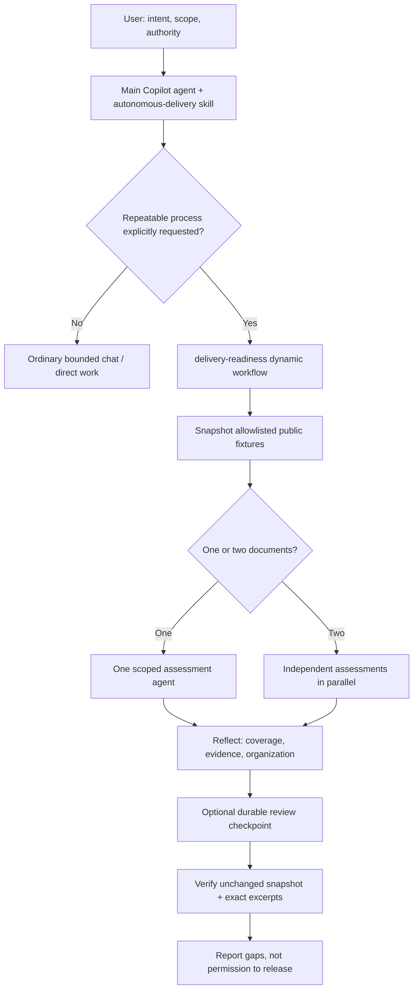

# Copilot skills + dynamic workflows: a hands-on guide

**Use a skill to guide judgment. Use a dynamic workflow to encode a repeatable process.**

This repository pairs Evan Boyle's **autonomous-delivery** agent skill with a
small, runnable **delivery-readiness** workflow. Learn how to install and invoke
the skill, create and share a workflow, run structured agents, check their
evidence, and pause/resume without treating partial work as success.

> Dynamic workflows are in **public preview**. Sources checked on **12 October
> 2026**; implementation targets **GitHub Copilot CLI 1.0.96-2**.
> See [sources and verification](docs/sources-and-verification.md) for the
> precise scope of the checks and preview caveats.

## The mental model

| Layer | What it provides | What it does not provide |
|---|---|---|
| `autonomous-delivery` skill | Instructions for organizing work, respecting scope, reflecting, and verifying outcomes | A workflow engine, new tools, credentials, or permission to publish |
| `delivery-readiness` workflow | JavaScript-defined stages, structured agent calls, progress, and durable checkpoints | Guaranteed-correct model judgment, exactly-once external effects, or release approval |
| You / the main Copilot session | Intent, model preferences, permissions, budget choices, and final acceptance | An implicit mandate for unlimited or recurring work |



**These are Copilot dynamic workflows, not GitHub Actions workflows.** Their
entry point is `.github/extensions/delivery-readiness/extension.mjs`, not a
YAML file in `.github/workflows/`.

## Start here

Use **Node.js 22 or newer**, Git, and optionally the GitHub CLI. No npm
dependencies need to be installed. The examples below use PowerShell.

```powershell
gh repo clone xavierxmorris/copilot-dynamic-workflows-guide
Set-Location .\copilot-dynamic-workflows-guide
npm run check
npm run demo:offline
```

The offline demo makes **no model calls** and uses **no Copilot AI credits**.
Its JSON is clearly marked `"simulation": true`. It exercises the same workflow
body with scripted responses; it is **not** a substitute for a live Copilot run.

For the live experience, you also need a signed-in Copilot CLI and access to
dynamic workflows on your plan/billing arrangement. See the current
[availability rules](https://docs.github.com/en/copilot/concepts/agents/dynamic-workflows#availability-of-dynamic-workflows).

Review the extension code before loading it, then launch Copilot **from this
repository**:

```powershell
copilot --experimental
```

In the interactive session:

```text
/skills reload
/skills info autonomous-delivery
What dynamic workflows are available?
```

If the project extension is not loaded, start a new session in this repository.
Creating or loading a workflow does not run it.

Then use both:

```text
Use the autonomous-delivery skill and explicitly run the delivery-readiness
dynamic workflow with arguments:
{"documents":["release-plan","runbook"],"pauseBeforeReport":false}

Assess only the public demo fixtures. Keep agents read-only and do not publish,
deploy, access credentials, delegate further, or schedule work. Explain why this
scope uses parallel assessments but no additional summarizer. Distinguish quoted
evidence checks from actual release acceptance.
```

The fixtures deliberately contain incomplete acceptance and recovery evidence.
Expect a report pointing to those gaps, not a release approval. Agent wording
and finding counts can vary. Compare the
[recorded real Copilot report](examples/verified-live-report.json), not just the
offline simulation.

**Direct terminal run** of the workflow, without a parent chat agent:

```powershell
$previousExtensionOptIn = $env:GITHUB_COPILOT_PROMPT_MODE_EXTENSIONS
$env:GITHUB_COPILOT_PROMPT_MODE_EXTENSIONS = "true"
try {
    New-Item -ItemType Directory -Force .\outputs | Out-Null
    copilot --experimental --available-tools= --deny-tool='shell,write,read,url,memory' workflow run delivery-readiness --args '@examples\workflow-input.json' --result-file .\outputs\live-report.json
    if ($LASTEXITCODE -ne 0) { throw "Workflow did not complete; do not trust an older result file." }
} finally {
    $env:GITHUB_COPILOT_PROMPT_MODE_EXTENSIONS = $previousExtensionOptIn
}
```

Only enable the extension trust variable for repository code you have reviewed.
This demo embeds fixture text in agent prompts, so agents need no tools.
The empty `--available-tools=` allowlist removes ordinary model tools; explicit
denials also cover file, shell, URL, and memory actions. The bare wildcard
`--deny-tool='*'` is **not valid** in the verified CLI version. Extension
JavaScript itself runs outside tool permission prompts. The result file is
produced by the CLI, and `outputs/` is gitignored.

**Important:** the direct terminal command runs the encoded process; it does
not separately invoke the parent chat skill. For the combined experience, use
the interactive prompt above. The workflow's worker prompts explicitly carry
the relevant skill principles instead of assuming automatic inheritance.

## Choose a learning path

| Resource | What you will learn |
|---|---|
| [Guided lab](docs/guided-lab.md) | Skill-only use, workflow authoring, combined use, pause/resume, and changing the organization |
| [Code walkthrough](docs/code-walkthrough.md) | Registration, snapshots, schemas, failures, memoization, and reflection |
| [Presenter run sheet](docs/presenter-run-sheet.md) | A short live demo with an honest offline fallback |
| [Troubleshooting](docs/troubleshooting.md) | Preview eligibility, extension trust, missing skills, null results, and resume behavior |
| [Sources and verification](docs/sources-and-verification.md) | Versioned evidence, official references, and limitations |

## What is in the repository?

```text
.github/
  extensions/delivery-readiness/
    extension.mjs              Copilot SDK registration
    workflow.mjs               Runnable, testable process
  skills/autonomous-delivery/
    SKILL.md                   Upstream skill v2.1.0, unchanged
    README.md
    LICENSE
docs/                          Walkthrough, lab, demo script, sources
examples/                      Normal, single-document, and pause inputs
fixtures/                      Fictional release plan and runbook
scripts/                       Clearly labeled offline simulation
test/                          Offline contract and failure-path tests
```

No private repository, personal configuration, credentials, real incident logs,
or actual application deployment is included. The demo is intentionally small:
scale it only after measuring useful outcomes and resource use.

## Attribution

The original guide and demo are MIT-licensed. The bundled **autonomous-delivery**
skill is **Copyright (c) 2026 Evan Boyle**, MIT-licensed, and preserved unchanged.
See [third-party notices](THIRD_PARTY_NOTICES.md) and the
[original gist](https://gist.github.com/EvanBoyle/8c1a97f682d92dab8c09d0e1ea73f4a0).
